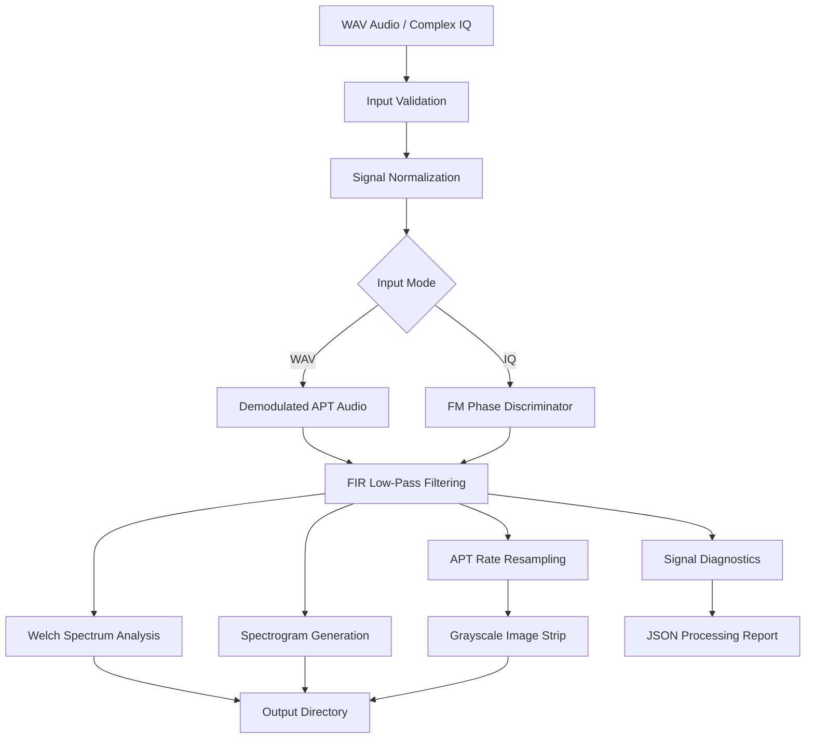

# NOAA APT Signal Processing Workbench

### Python-Based Digital Signal Processing for Weather Satellite Signal Analysis

<p align="center">
  
  
  
  
  
</p>

## Overview

The **NOAA APT Signal Processing Workbench** is an independent Python-based project focused on Digital Signal Processing (DSP), Software-Defined Radio (SDR), and weather satellite signal analysis.

The project explores the processing of NOAA Automatic Picture Transmission (APT) recordings through a modular signal-processing pipeline.

Using NumPy, SciPy, Matplotlib, and Pillow, the application performs signal preprocessing, FIR filtering, frequency-domain analysis, FM demodulation for complex IQ recordings, and preliminary grayscale image reconstruction.

The primary objective is to develop practical experience in satellite communications, digital signal processing, and scientific computing.

## Key Features

- **WAV Audio Processing:** Load and analyze recorded, already-demodulated NOAA APT audio.
- **Complex IQ Processing:** Process complex baseband samples stored in NumPy `.npy` files.
- **FM Demodulation:** Phase-difference FM discriminator for complex IQ input.
- **FIR Filtering:** Windowed-sinc low-pass filtering with a Hamming window.
- **FFT & Spectral Analysis:** Frequency-domain inspection using Welch power spectral estimation.
- **Waterfall Analysis:** Time-frequency visualization through spectrograms.
- **Signal Resampling:** Polyphase resampling to the nominal APT image sampling rate.
- **Image Reconstruction:** Preliminary grayscale APT image-strip generation.
- **Processing Diagnostics:** RMS, peak-level, signal-duration, and configuration reporting in JSON.

## System Architecture



## Technology Stack

| Technology | Application |
|---|---|
| Python | Core implementation |
| NumPy | Numerical computation and IQ data |
| SciPy | FIR filtering, FM processing and resampling |
| Matplotlib | Spectrum and spectrogram visualization |
| Pillow | Grayscale image generation |

## Project Structure

```text
noaa-apt-signal-processing/
│
├── README.md
├── noaa-apt.py
├── requirements.txt
├── LICENSE
├── .gitignore
│
└── results/
    ├── filtered_audio.wav
    ├── spectrum.png
    ├── spectrogram.png
    ├── apt_image_strip.png
    └── report.json
```

The `results/` directory is generated automatically when the application runs.

## Installation

### Prerequisites

- Python 3.10 or later
- pip package manager
- Recorded NOAA APT WAV audio or complex IQ data

### 1. Clone the repository

```bash
git clone https://github.com/YOUR-USERNAME/noaa-apt-signal-processing.git
```

### 2. Navigate to the project

```bash
cd noaa-apt-signal-processing
```

### 3. Install dependencies

```bash
pip install -r requirements.txt
```

## Usage

The application supports two processing modes.

### Mode 1: WAV Audio Processing

Use an existing WAV recording containing demodulated APT audio.

```bash
python noaa-apt.py audio noaa_apt.wav --out results
```

### Mode 2: Complex IQ Processing

Use complex baseband samples stored in a one-dimensional NumPy `.npy` file.

```bash
python noaa-apt.py iq recording.npy --sample-rate 240000 --out results
```

Replace the sample rate with the actual recording sample rate.

### Available Parameters

| Parameter | Description | Default |
|---|---|---|
| `--out` | Output directory | `results` |
| `--cutoff` | FIR low-pass cutoff frequency | 6000 Hz |
| `--taps` | FIR filter length | 129 |

Example:

```bash
python noaa-apt.py audio noaa_apt.wav --cutoff 5000 --taps 201 --out results
```

View available commands:

```bash
python noaa-apt.py --help
```

## Output Files

After successful processing, the application generates:

| File | Description |
|---|---|
| `filtered_audio.wav` | Filtered and normalized audio |
| `spectrum.png` | Average power spectrum |
| `spectrogram.png` | Time-frequency visualization |
| `apt_image_strip.png` | Preliminary grayscale image strip |
| `report.json` | Processing configuration and signal diagnostics |

## NOAA APT Technical Reference

NOAA Automatic Picture Transmission is an analog weather-image transmission format used by compatible NOAA polar-orbiting satellites.

Important nominal characteristics:

| Parameter | Value |
|---|---|
| Image line rate | 120 lines/minute |
| Image sampling rate | 2080 samples/second |
| Samples per line | 2080 |
| Image channels | 2 |
| Nominal image width | 2080 samples per line |

These parameters provide the foundation for studying APT signal timing and image reconstruction.

## Current Implementation Limitations

This project is an evolving research prototype.

The current implementation performs nominal-rate image-strip reconstruction rather than complete operational APT decoding.

The following capabilities are not yet implemented:

- Automatic APT synchronization-pulse detection.
- Pixel-clock and timing recovery.
- Automatic separation of the two APT image channels.
- Complete calibrated image reconstruction.
- Live SDR hardware acquisition and tuning.

The IQ processing mode uses a basic phase-difference FM discriminator. The WAV mode expects already-demodulated APT audio.

## Development Roadmap

- [x] WAV audio input
- [x] Complex IQ input using NumPy
- [x] Basic FM phase-difference demodulation
- [x] FIR low-pass filtering
- [x] Welch power spectrum analysis
- [x] Spectrogram visualization
- [x] Polyphase resampling
- [x] Preliminary grayscale image reconstruction
- [x] JSON processing reports
- [ ] Automatic APT synchronization
- [ ] Pixel-clock recovery
- [ ] Two-channel image separation
- [ ] Complete NOAA APT image decoder
- [ ] Automated signal-quality testing
- [ ] Reference recording validation

## Research Areas

- Digital Signal Processing (DSP)
- Software-Defined Radio (SDR)
- Satellite Communications
- Frequency Modulation (FM)
- FIR Digital Filtering
- FFT and Spectral Analysis
- Complex IQ Signal Processing
- Signal Demodulation
- Weather Satellite Image Reconstruction
- Python Scientific Computing

## Author

**Aditya Sharan (ayn_hex)**

Aspiring Aerospace & Satellite Cybersecurity Researcher

Technical interests:

- Aerospace and Satellite Cybersecurity
- Satellite Communications
- Software-Defined Radio
- Digital Signal Processing
- Vulnerability Research
- Systems Programming

GitHub: https://github.com/aditysharan17

LinkedIn: www.linkedin.com/in/aditya-sharan17

## Disclaimer

This is an independent educational and research project. It is not affiliated with, endorsed by, or an official product of NOAA or NASA.

The project processes existing recordings and does not independently acquire or transmit satellite signals.

## License

Distributed under the MIT License. See the LICENSE file for details.

---

<p align="center">
  <strong>Exploring Digital Signal Processing and Satellite Technology through Python.</strong>
</p>
