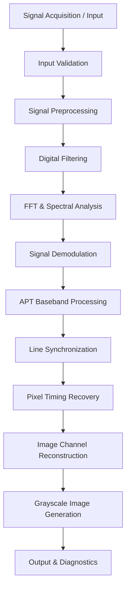

# NOAA APT Signal Processing Workbench

### Python-Based Digital Signal Processing and Weather Satellite Image Reconstruction

<p align="center">
  <strong>Analyzing • Processing • Demodulating • Reconstructing</strong>
</p>

<p align="center">
  
  
  
  
  
</p>

---

## Overview

The **NOAA APT Signal Processing Workbench** is a Python-based research and learning project focused on digital signal processing (DSP) techniques used in the analysis and reconstruction of NOAA Automatic Picture Transmission (APT) weather satellite signals.

The project explores the signal-processing workflow involved in transforming recorded satellite transmissions into interpretable image data.

Built using Python and scientific computing libraries, it brings together digital filtering, frequency-domain analysis, signal demodulation, and image reconstruction in a modular processing pipeline.

The objective is to develop practical knowledge of software-defined radio (SDR), satellite communications, and digital signal processing through hands-on experimentation.

## Project Objectives

- Develop a modular Python-based DSP pipeline.
- Explore the processing of NOAA APT audio and SDR IQ recordings.
- Implement digital filtering and frequency-domain analysis.
- Understand FM demodulation and signal characteristics.
- Investigate APT synchronization and image reconstruction.
- Generate visualizations and diagnostic reports for signal analysis.

## System Architecture

The intended processing architecture consists of the following stages:



*Note: This diagram represents the intended architecture. Not every stage is implemented in the current prototype.*

## Technical Features

### 1. Signal Acquisition and Preprocessing

- Load recorded WAV signals.
- Support complex IQ processing workflows.
- Normalize signal amplitude.
- Validate input data and sample rates.
- Prepare recordings for subsequent DSP operations.

### 2. Digital Signal Processing

- Digital filtering and noise reduction.
- FIR filter implementation and experimentation.
- Signal normalization and conditioning.
- Configurable processing parameters.

### 3. Frequency-Domain Analysis

- Fast Fourier Transform (FFT).
- Power spectral analysis.
- Time-frequency visualization.
- Waterfall and spectrogram generation.

### 4. Signal Demodulation

- FM demodulation concepts.
- Complex IQ signal processing.
- APT brightness signal extraction from suitable audio recordings.
- Signal inspection and diagnostics.

### 5. Image Reconstruction

- APT image-line sampling concepts.
- Pixel-rate resampling.
- Grayscale image generation.
- Image export and visualization.

### 6. Processing Diagnostics

- Signal amplitude measurements.
- Sample-rate and duration information.
- Frequency visualization.
- JSON processing reports.

## Technology Stack

| Technology | Application |
|---|---|
| Python | Core development |
| NumPy | Numerical computation |
| SciPy | Digital signal processing |
| Matplotlib | Signal visualization |
| Pillow | Image processing |
| WAV / IQ | Signal input formats |
| SDR | Satellite signal reception concepts |

## Project Structure

```text
noaa-apt-signal-processing/
│
├── noaa_apt.py
├── requirements.txt
├── README.md
│
├── results/
│   ├── spectrum.png
│   ├── spectrogram.png
│   ├── reconstructed_image.png
│   └── processing_report.json
│
├── samples/
│   └── sample_recording.wav
│
└── .gitignore
```

*The directory structure above describes the recommended organization; actual filenames may vary by implementation.*

## Installation

### Prerequisites

- Python 3.10 or later
- pip package manager
- A recorded NOAA APT audio signal
- Optional SDR hardware for signal acquisition

### 1. Clone the repository

```bash
git clone https://github.com/YOUR-USERNAME/noaa-apt-signal-processing.git
```

### 2. Navigate into the project

```bash
cd noaa-apt-signal-processing
```

### 3. Install dependencies

```bash
pip install -r requirements.txt
```

## Usage

Place a compatible NOAA APT WAV recording in the project directory.

Run the processing pipeline:

```bash
python noaa_apt.py audio noaa_apt.wav --out results
```

Check the command-line help for supported input formats and processing options:

```bash
python noaa_apt.py --help
```

## Expected Outputs

The processing workflow is designed to generate:

| Output | Description |
|---|---|
| Spectrum plot | Frequency-domain signal visualization |
| Spectrogram | Time-frequency analysis |
| Filtered audio | Processed signal recording |
| Reconstructed image | Grayscale APT image output |
| JSON report | Processing information and diagnostics |

Actual output availability depends on the implemented processing stages.

## NOAA APT Technical Background

NOAA APT is an analog weather-image transmission format used by compatible NOAA polar-orbiting satellites.

Some important technical characteristics include:

| Parameter | Nominal value |
|---|---|
| Image line rate | 120 lines/minute |
| Image sampling rate | 2080 samples/second |
| Image channels | 2 |
| Samples per line | 2080 |
| Pixels per channel per line | 909 nominal image pixels |

The project uses these characteristics as a foundation for studying signal synchronization and image reconstruction.

## Development Roadmap

- [x] Python signal input and preprocessing
- [x] Signal normalization
- [x] Digital filtering
- [x] FFT and spectrogram visualization
- [x] Basic grayscale image reconstruction
- [x] Initial processing diagnostics
- [ ] Validated SDR IQ acquisition workflow
- [ ] Robust FM demodulation
- [ ] Automatic APT synchronization
- [ ] Pixel-clock recovery
- [ ] APT channel separation
- [ ] Complete two-channel image reconstruction
- [ ] Automated testing with reference recordings
- [ ] Image quality and SNR evaluation

## Research and Learning Areas

This project provides practical exposure to:

- Digital Signal Processing (DSP)
- Software-Defined Radio (SDR)
- Satellite Communications
- Frequency Modulation (FM)
- FIR Filtering
- Fast Fourier Transform (FFT)
- Spectral Analysis
- Signal Demodulation
- Image Signal Reconstruction
- Python Scientific Computing

## Future Improvements

Future development will focus on improving synchronization accuracy, implementing robust image-channel reconstruction, supporting additional SDR recording formats, and introducing automated signal-quality evaluation.

## Author

**Aditya Sharan (ayn_hex)**

Aspiring Aerospace & Satellite Cybersecurity Researcher

Interested in:

- Aerospace and Satellite Security
- Software-Defined Radio
- Satellite Communications
- Digital Signal Processing
- Vulnerability Research
- Python and Systems Programming

GitHub: https://github.com/aditysharan17

LinkedIn: www.linkedin.com/in/aditya-sharan17

## Disclaimer

This is an independent educational and research project. It is not affiliated with, endorsed by, or an official product of NASA or NOAA.

All radio reception and recording activities should comply with applicable laws and regulations.

## License

This project is released under the MIT License. See the `LICENSE` file for details.

---

<p align="center">
  <strong>Exploring the intersection of Python, signal processing, and satellite technology.</strong>
</p>
